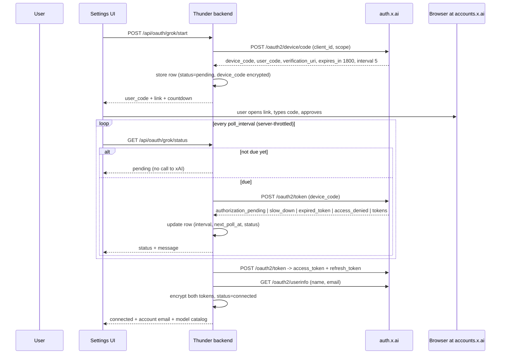

# Sign in with Grok (xAI subscription, OAuth device code)

Lets the app answer with your **SuperGrok / X Premium+ subscription** instead of
a pay-per-token xAI API key. It is opt-in: with `GROK_OAUTH_ENABLED` unset the
feature's routes answer `503` and nothing else changes.

## 1. There is no OAuth app to register

The task this file replaces asked for "client_id and client_secret from the xAI
developer console". That step does not exist, and pretending otherwise would
mean a dead config knob:

* xAI publishes **no OAuth application registration**. `docs.x.ai` has no such
  page and `accounts.x.ai/developers` is not an app (Cloudflare block page).
* The device flow uses a **public client** — the id shipped with the Grok CLI.
  A public client has no secret by definition, so there is
  **`GROK_OAUTH_CLIENT_ID` and no client-secret setting anywhere**. The value is
  baked into `app/services/oauth_grok.py` (`DEFAULT_CLIENT_ID`) and can be
  overridden by env only if xAI rotates it.
* Consequently this integration impersonates the official Grok CLI client. That
  is how every third-party Grok OAuth tool works, but xAI's consumer terms do
  not offer a third-party-client allowance, so treat it as **at your own risk**:
  the client can be revoked, and a `402`/`403` can appear even on an active plan.

What xAI *does* publish is the authorization server itself, so no guessing was
needed — these are the live values from
<https://auth.x.ai/.well-known/openid-configuration>:

| Purpose | Endpoint |
| --- | --- |
| Device authorization | `https://auth.x.ai/oauth2/device/code` |
| Token (poll + refresh) | `https://auth.x.ai/oauth2/token` |
| Userinfo | `https://auth.x.ai/oauth2/userinfo` |
| Revocation | `https://auth.x.ai/oauth2/revoke` |

Grant type: `urn:ietf:params:oauth:grant-type:device_code`.
Default scope set: `openid profile email offline_access grok-cli:access api:access`.
(`grok.access`, which circulates in write-ups, is not a published scope.)

## 2. Enabling it

```bash
# .env
ENCRYPTION_KEY=...            # required: tokens are encrypted with this key
GROK_OAUTH_ENABLED=true
```

That is the whole configuration. Then: **Settings → Providers → Sign in with
Grok**. To use an API key instead, add a normal Grok provider row
(`GROK_API_KEY` / `xai-…` from <https://console.x.ai>) — no OAuth involved.

## 3. Login flow



Chat then goes to `https://cli-chat-proxy.grok.com/v1/responses` with
`Authorization: Bearer <access_token>` plus the Grok-CLI identity headers.

No background task and no loopback callback server are involved: the browser
polls the app, and the app polls xAI at the server-advertised interval. That
keeps a half-finished sign-in alive across a restart, which a coroutine would
not survive in either the packaged build or on Render.

## 4. Token lifecycle

| Concern | Behaviour |
| --- | --- |
| Access token expiry | Read from the JWT `exp`; no `expires_at` is published |
| Renewal | Automatically `GROK_OAUTH_EXPIRY_SKEW_S` (default 300 s) before expiry |
| Rotation | xAI consumes the old refresh token — the rotated pair is persisted immediately, under a per-user single-flight lock so two concurrent requests cannot both spend it |
| Refresh fails | Row → `error`, credentials cleared, UI says sign in again. **No fallback to an API key** |
| `401` from the proxy | One forced refresh and one retry, then give up |
| `402` / `403` | "No subscription access to the model catalog" — re-signing-in cannot fix an entitlement gate |
| `429` | Rate-limit copy; the subscription's limits are not the API's |
| Sign out | `POST /oauth2/revoke` for the refresh token, then always delete the local row (a refused revocation still signs you out locally) |

## 5. What "subscription status" can and cannot show

`userinfo` publishes only identity claims (`sub`, `name`, `email`, `picture`, …)
— **there is no plan or tier field**. So the settings card shows:

* who is signed in (name + email);
* **which models this account can list**, from `GET /v1/models-v2` with the
  account's own bearer — presence in that catalog is the entitlement signal, and
  it is why the card says "N subscription models" rather than inventing a tier
  label. API-key-only models (e.g. `grok-build-0.1`) and non-chat surfaces
  (`imagine`, `embed`, `voice`, `video`) are filtered out.

## 6. Files

| Path | Role |
| --- | --- |
| `backend/app/services/oauth_grok.py` | Device-code client: request, poll, refresh, userinfo, revoke, expiry maths |
| `backend/app/services/oauth_token_store.py` | Encrypted storage + auto-refresh + single flight |
| `backend/app/routes/oauth.py` | `/api/oauth/grok/start\|status\|refresh\|account` and `DELETE /api/oauth/grok` |
| `backend/app/services/llm_providers/grok_provider.py` | Grok provider: subscription (Responses) and API-key (chat-completions) |
| `backend/app/models/models.py` | `ProviderOAuthToken` table (one row per user + provider) |
| `frontend/src/GrokOAuth.tsx` | Sign-in card, device-code dialog, countdown, account + models, sign out |
| `tests/test_oauth_grok_service.py` | Protocol: request/poll/refresh/revoke/expiry, no secrets logged |
| `tests/test_oauth_token_store.py` | At-rest encryption, rotation, single flight, fail-closed |
| `tests/test_oauth_routes.py` | HTTP surface: auth, CSRF, gating, throttle, no token in responses |
| `tests/test_grok_provider_config.py` | Config defaults/validation and subscription-vs-key resolution |
| `tests/test_grok_provider.py` | Both transports: URLs, headers, body keys, streaming, status handling |

## 7. Limits of this implementation

* **The subscription applies to an active provider row, not to the legacy
  settings row.** `settings_service.provider_config_for_row()` (used by the
  multi-provider manager) is where "this user is signed in with a subscription"
  is recognised. A user still on the old single-provider `user_settings` record
  keeps the API-key path, so switch to a Grok row in Settings → Providers.
* Not exercised against a live account: the protocol shape comes from xAI's
  discovery document plus several working third-party implementations, and the
  tests mock every endpoint. First real sign-in should be watched.
* The proxy's identity headers pin a client version (`x-grok-client-version`);
  if xAI tightens the gate, that constant is the thing to update.
* The CLI chat proxy's Responses/billing surfaces are not a published contract,
  so catalog parsing is deliberately defensive, and image parts are dropped from
  subscription requests (with a warning) because that transport is unverified.
* ChatGPT sign-in (Phase 2 of the original request) is **not** implemented:
  OpenAI's flow is authorization-code + PKCE against `auth.openai.com` with a
  loopback callback, not the device flow this code is built around, and its
  availability for personal accounts is not something I could confirm. The
  provider/service/store/routes are keyed by provider name, so a second provider
  is additive.
